<p align="center">
  
</p>

<p align="center">
  <a href="https://aryan-bose-portfolio.vercel.app/"></a>
  <a href="https://www.linkedin.com/in/aryan-bose-b73960227/"></a>
  <a href="mailto:aryanbose.710@gmail.com"></a>
</p>


## `> whoami`

```yaml
name:        Aryan Bose
role:        Final-year CSE student @ MITE, Mangalore
builds:      LLM systems you can measure (RAG that cites or abstains,
             prompt regression testing) and full-stack Flask / React apps
looking_for: GenAI / AI Engineering / Software Development internship
location:    Bangalore | Remote
available:   mid-December 2026
```


## `> ls ./projects`

<table>
<tr>
<td width="50%" valign="top">
<code>module_01 · rag</code>
<h3><a href="https://github.com/AryanB710/ask-my-docs">Ask My Docs</a></h3>
<p>Production-style RAG with an eval gate. Every sentence must cite its source or the system abstains. Hybrid retrieval (BM25 + vectors), reranking, per-request tracing, and CI that blocks merges which make answers worse.</p>


</td>
<td width="50%" valign="top">
<code>module_02 · llm-evals</code>
<h3><a href="https://github.com/AryanB710/EvalTrack-LLM-Prompt-Regression-Testing-Platform">EvalTrack</a></h3>
<p>Prompt evaluation and regression testing for LLM apps. Runs a suite of test prompts, scores the outputs, and flags regressions between prompt or model versions.</p>

</td>
</tr>
<tr>
<td width="50%" valign="top">
<code>module_03 · nlp</code>
<h3><a href="https://github.com/AryanB710/location-recommendation-system">Location Recommendation System</a></h3>
<p>Paste in a video script and get real shooting locations for every scene. BERT ranks Google Places results by how well they match each scene, and Open-Meteo adds the weather forecast.</p>


</td>
<td width="50%" valign="top">
<code>module_04 · fintech</code>
<h3><a href="https://github.com/AryanB710/payment-reconciliation-tracker">Payment Reconciliation Tracker</a></h3>
<p>Flask app that reconciles orders, payments and settlements, and tracks every exception with an audit trail.</p>


</td>
</tr>
<tr>
<td colspan="2" valign="top">
<code>module_05 · frontend</code>
<h3><a href="https://github.com/AryanB710/portfolio-site">3D Portfolio</a></h3>
<p>Interactive 3D portfolio with a teal-on-black theme. <a href="https://aryan-bose-portfolio.vercel.app/">See it live →</a></p>


</td>
</tr>
</table>


## `> cat research.log`

```diff
+ [2027] Paper accepted at AICCoNS 2027
+ [cert] Machine Learning Specialization · DeepLearning.AI
+ [cert] Generative AI for Software Development · DeepLearning.AI
+ [cert] Introduction to Machine Learning · Google Developers
+ [cert] NPTEL Introduction to Virtual Reality · Silver (80%)
```


## `> stack --list`

<p align="center">
  
</p>

<p align="center"><code>LLMs · RAG · BM25 + vector retrieval · reranking · BERT · LLM evaluation · Tableau</code></p>


